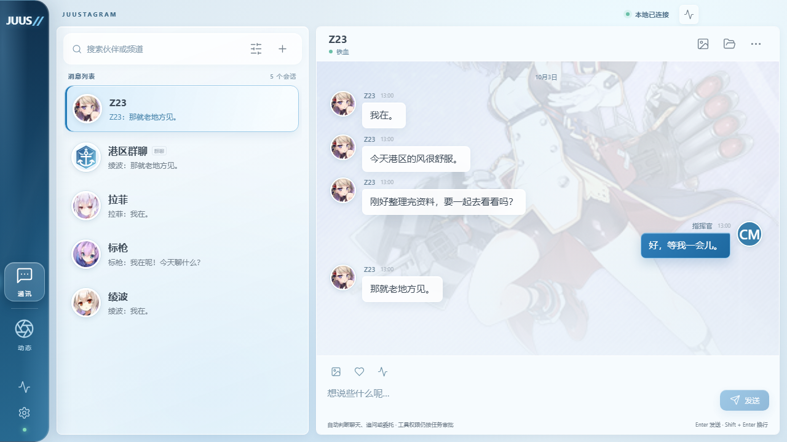
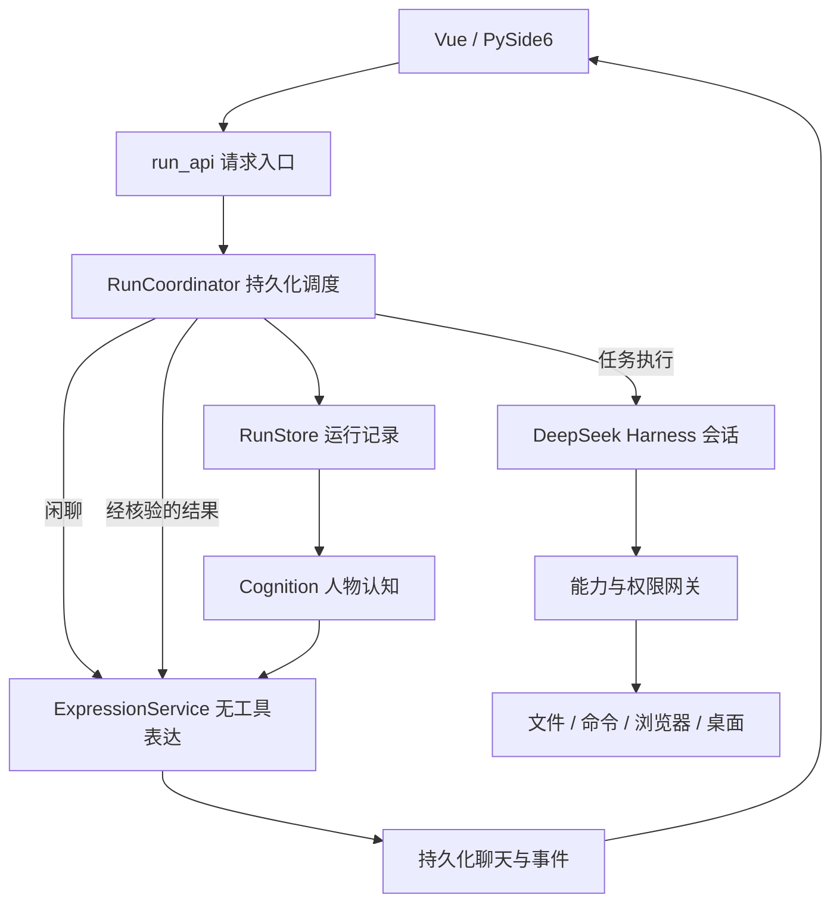

<div align="center">

# AzurJuus

本地运行的 Agent 桌面应用




</div>

---

## 项目简介

AzurJuus 是一个在 Windows 本机运行的角色化 Agent 桌面应用。JUUS 是港区成员日常使用的远程聊天软件，提供私聊、群聊、朋友圈和工作抽屉。输入框默认由模型判断闲聊、追问或明确委托；也可手动选择模式。只有进入已有受限任务流程后，角色才能在授权范围内实际读写文件、执行命令、读取 PDF/DOCX/XLSX 或操作浏览器等工具。频道成员资格不表示人物在线、同处一地或待命。

本项目为个人兴趣学习项目，且暂未达到个人预期。

2026-10-06 完成[人物提示链检查](docs/PROMPT_AUDIT_20261006.md)：日常表达与工具工作策略分开，问候及长时间间隔不自动重启旧约定；原始角色资料和聊天历史保留。本机 Harness 实际请求未混入默认工程助手身份。相关上下文回归与人格自然度验收是两件事，实际自然度仍需观察。

同日补齐[表达阶段的时间上下文](docs/CHAT_TIME_CONTEXT_20261006.md)：私聊、群聊、自主交流和动态表达均获得本机日期时间及时区，重试会刷新时钟；明确的未来安排和回忆保留，群聊历史提供可读消息时间。模型能收到时间不等于每次都会正确理解场景，实际角色表达仍需复验。

同日强化[群聊发言归属](docs/SPEECH_ATTRIBUTION_20261006.md)：显式绑定当前角色 ID，按原始作者区分本人和同伴的历史发言，并使用对应的对话轮次；原始记录与记忆归属保留，后来认错或转述不改变原话作者。模型输出的归属错误仍需结合上下文核查。

仍需持续核查：
- 不同模型可能偶发返回空白或非 JSON 正文；结构化回复会有限重试，仍失败时明确报错，真实工作回复需按模型复验。
- 人物资料抓取的准确性需按角色和来源逐个核对。

系统分成三个部分：

- **AzurJuus 本体** — 持久化调度、权限校验、任务状态与人物状态
- **DeepSeek Harness** — 官方 Python SDK 与配套原生运行时管理模型会话和工具调用，使用配置的 DeepSeek 兼容接口
- **独立表达服务** — 把允许公开的事实组织成角色短消息，它不接触工具

对应到运行时有五个职责：界面负责接收与展示，调度器管理持久化工作，官方 DeepSeek Harness 决定下一次模型或工具调用，权限网关真正操作本机，表达层负责角色说话。`kernel/` 使用官方 Cordis 管理插件依赖、事件和卸载；工作区工具由 Harness 直接加载原生插件。Python 保留授权、执行证据及领域存储，计划修订与外援成员管理独立为 `WorkflowPlans`。

消息处理方式：

- **自动判断** — 模型只给出结构化路由决定；含糊委托进入澄清，路由本身不授予工具权限。已有本人核验阅读的私聊追问可由证据校正为结果追问，明确要求重新读取仍须走新委托。推断出的私聊协作先展示参与者和本条委托摘要，确认后另建协作群。
- **闲聊** — 单纯的角色扮演。
- **任务** — 调度器保存运行记录并启动 DeepSeek Harness 会话，执行操作。
- **协作** — 多角色协同完成任务。

## 功能

| 方向 | 当前实现 | 边界 |
| --- | --- | --- |
| 普通对话 | 由角色卡、可见经历和最近对话组成上下文，无工具权限；亲自完成的阅读可在已加入的频道被追问 | 多本资料指代不清时要求澄清；表达自然度仍需人工对照评价 |
| 单人任务 | 规划确认 → 执行与交付 → 秘书和用户逐阶段验收 → 独立最终复核与确认 → 角色回复 | 开放式报告的语义正确性仍需合适的验收条件 |
| 多成员协作 | 依赖子任务、最多两名成员并行、成员定向讨论、结果回传原会话 | 讨论建议不能直接改写别人的任务，调整仍需调度校验 |
| 文件与文档 | 分页、搜索、精确补丁、复制移动、快照与撤销；文本及扫描 PDF 读取，DOCX / XLSX 读写 | 扫描页在本机 OCR，提供来源和置信度；低清、手写和复杂版式仍需人工核对 |
| 编程 | 修改文件、执行命令、检查输出与退出码、超时与取消 | 示例代码修改与测试修复通过，不代表能自动维护任意仓库 |
| 浏览器 | Playwright 导航、读取、填写、点击、下载，使用任务独立配置 | 本地表单与下载通过，不承诺任意网站稳定自动化 |
| Windows 桌面 | UIA 控件交互、窗口焦点、DPI 缩放、资源管理器整理、停止检查 | 含 Explorer 导航与剪切粘贴实机记录，不含 Office/WPS GUI |
| 人物状态 | 基础卡版本、按人物和会话隔离的可见经历、定向关系、长期目标与在线生活；群聊最多两名候选并发判断、逐条发表 | 不展示或声称控制模型内部真实思维链；自然度仍需人工盲评 |
| 朋友圈 | 总动态页汇集可见和仅供用户查看的记录；加号进入发布页，用户可点赞与评论有权限的动态；人物按新事件或到期想法自主选择发布、回应或沉默 | 人物私下活动不自动公开；共同活动分享须参与者分别同意；后台额度与免打扰仍生效 |
| 任务与聊天并行 | 工作角色退出群聊候选，点名请求可等任务完成后再判断；新话题或重启使待回复失效 | 任务执行与交付保持优先，待回复不冒充已发表台词 |
| 表达投递 | 稳定编号，状态经过排队 → 正文就绪 → 已投递；失败只重投，不重新生成 | 两个数据库之间仍可能暂时不同步，靠恢复补齐 |
| 方法成长 | 从本人已验收任务提出方法及三个场景，秘书审核、用户确认后与原方法隔离比较，通过才启用，可回退 | 支持合成文件、JSON、DOCX、XLSX 的声明式验收；不训练模型权重，不据三个场景推断所有任务有效 |
| 方法选择 | 任务模型通过 method_search 自主检索，再以 method_select 组合至多四项可见方法，也可不选 | 只允许已验证公有方法或本人的有效方法；选择不授予工具权限，变更或停用后须重新选择 |
| 公有方法 | 稳定试用证据 → 后台秘书复核 → 用户确认；提案绑定源方法和内容摘要，撤回及回滚保留审批记录 | 客户端不能指定秘书结论，源方法改变后须重新提案 |
| 外援与重排 | 从当前连接成员申请外援；用户批准后同步入群并唤醒执行器，秘书可修订依赖图 | 保留正在执行及已完成的分工和证据；同一人物不会并行执行两个子任务 |
| 恢复 | 持久化状态、过期审批失效、未知副作用核验、运行中原生追加要求及送达记录 | 未送达的补充保留到继续任务；恢复的是任务上下文，不是原进程的内存快照 |
| 界面 | 深海蓝导航、蓝白磨砂面板、本人消息标识、按会话串行的气泡队列 | 支持减少动态效果和减少透明度；帧率只有测试场景的采样，不代表所有机器 |

上次审计明确列出的五项功能缺口已补齐：通用阶段门禁、高风险操作双审、自主检索组合方法、有证据的通用方法演化、本地扫描 PDF OCR。实施与当前验证见 [功能缺口收尾记录](docs/FUNCTIONAL_GAPS_20261004.md)；[此前审计](docs/PLAN_AUDIT_20261004.md)保留历史发现及验收范围。人物盲评、长期运行、全新机器安装和可选服务器部署等验收不据此视为通过。

任务执行前和每个子任务交付后，会先由当前已连接的秘书独立复核，再在「工作记录 → 阶段验收」等待用户通过或要求修订。待验收文件可以直接下载核对。拒绝保留实际文件和修订意见；暂停或重启后仍可继续确认，不重做已提交的写入。追加要求、重排计划或文件变化会阻止使用旧确认。闲聊不进入任务门禁。

命令执行、覆盖已有文件、复制移动覆盖、恢复撤销及规定的浏览器和桌面副作用先通过秘书预审，再等待用户确认具体参数。每条命令单独审批，不以一次确认永久放行后续命令；审批期间目标发生变化必须重新申请。普通新文件写入仍在交付阶段验收。

在成员的「方法与成长」中，可从已使用的方法点击「从已验收任务改进方法」。新方案保持停用，显示秘书结论及三组输入与验收条件；用户确认后在新隔离目录运行三组原方法与三组新方法。只有新方法三个场景均通过实际文件断言才启用，之后可以停用、回滚或申请公有共享。没有可靠的可执行验收条件时，不声明已经学会。

## 关键机制

| 机制 | 实现 | 边界 |
| --- | --- | --- |
| 执行可靠性 | 调用记录、审批、结构化交付、复核 | 不保证开放式内容永远正确 |
| 恢复 | 持久化状态、事件、请求编号、未知副作用核验 | 任意外部操作不一定可撤销 |
| 事件一致性 | 源事件、消费游标、幂等收件、短事务 | 不是跨库全局事务 |
| 人格连续性 | 基础卡、可见经历、定向关系、版本检查 | 不是完整人类心智模拟 |
| 表达隔离 | 无工具模型、事实包、对象、短消息校验 | 细微失真仍需评测 |
| 投递恢复 | 稳定编号、待投递正文、幂等写入 | 允许暂时不同步后补齐 |
| 技能成长 | 来源候选、三个隔离场景、基线比较、回退 | 有限任务族，不训练权重 |
| UI 稳定性 | 组件局部更新、本人标识、气泡队列 | 性能需要实测 |

其他几处设计：

- 权限校验放在工具网关里，不写在提示词里。路径先解析真实目标再判断是否越界，符号链接和 Windows junction 越界都有回归覆盖。
- 模型等待期间不持有数据库写事务。云端等待可能持续几十秒，长写事务会阻塞其他任务和聊天；实现先取快照、结束事务，再等待模型，最后用短事务提交。人物反思还会检查状态版本，旧结果不能覆盖等待期间的新承诺。
- 崩溃后不自动重放。副作用结果未知时任务转为暂停，需要人工核验文件后再继续。
- `AZURJUUS_EXPRESSION_ENABLED=0` 关闭独立表达层，直接展示执行会话的消息；已有聊天和投递记录保留。默认开启。

## 架构



三个要点：

1. 模型选择下一步动作，应用决定是否允许执行。
2. AzurJuus 负责调度，DeepSeek Harness 负责模型循环，两边不重复创建和推进任务。
3. 界面显示的是工具记录和持久化事件里的真实状态，角色口吻只负责表达。

进程模型：Qt 主线程管理窗口，Uvicorn 在同一应用进程的后台线程运行；官方 DeepSeek Harness SDK 启动独立原生内核进程，直接加载 `kernel/native/workspace.mjs`，通过本机 HTTP 访问权限网关。没有额外 MCP 工具子进程。工具及轮次的原生生命周期事件进入 RunStore，再投影到界面。

内核使用官方 `sdk-minimal` 配置，并关闭内置终端工具、引擎身份和运行环境提示词。系统提示词由人物设定与应用工作规则组成，工具权限仍在应用网关校验。

每个执行阶段独立拥有一个内核会话。追加要求通过官方 `session/prompt` 进入正在运行的会话，以根会话的收件箱事件确认送达；只排队而未进入上下文的要求不会标记为已送达。暂停、取消、超时或事件处理失败会关闭该阶段的内核并等待后台调用结束，再释放工具令牌。启动与关闭共享一次生命周期，防止重复启动或关闭后重新拉起进程；启动中的取消等待官方初始化结束后回收（初始化超时当前为 90 秒）。

### 技术栈

| 层 | 技术 | 职责 |
| --- | --- | --- |
| 桌面壳 | Python、PySide6 6.11.2、QWebEngine | 无边框窗口、缩放、服务启动与异步退出 |
| 界面 | Vue 3、TypeScript、Vite 7 | 私聊、群聊、朋友圈、设置、工作抽屉、认知与方法面板 |
| API | FastAPI、Uvicorn | 消息接收、任务控制、工具入口、产物下载、WebSocket |
| 调度 | asyncio、`RunCoordinator` | 依赖推进、并发、审批、暂停恢复、交付验收与复核 |
| 执行核心 | 官方 DeepSeek Harness SDK / 原生运行时 0.1.5rc1 | 模型会话与工具调用循环，DeepSeek 兼容接口接入 |
| 工具接入 | 官方 Cordis 原生插件 + 本机 HTTP | 阶段工具目录、权限错误、取消及图像附件通过统一契约处理 |
| 表达与人物 | `expression.py`、`cognition.py`、`terminal_characters.py` | 短消息生成与校验、经历与关系、基础卡与世界条目 |
| 业务存储 | SQLAlchemy 2.0 + SQLite | 角色、会话、消息、设置、动态、技能 |
| 执行存储 | `sqlite3`、`RunStore`、FTS5 | 任务、调用、审批、事件、表达投递、已验证任务总结 |
| 文档 | pypdf、pypdfium2、RapidOCR / ONNX Runtime、python-docx、openpyxl | 文本与扫描 PDF 本地读取、Office 格式读写 |
| 浏览器 / 桌面 | Playwright、pywinauto、pywin32 | 独立浏览器配置、Windows UI Automation |
| 凭据 | Windows DPAPI（其他平台走 keyring） | 加密保存密钥，HTTP 只暴露是否已配置 |

## 环境要求

| 项 | 要求 |
| --- | --- |
| 操作系统 | Windows 11（开发与验证环境） |
| Python | 3.11 – 3.13（已验证 3.12.13） |
| Node.js | 22 LTS |
| 其他 | Git，以及一个可访问的模型服务 |

## 安装

```powershell
git clone https://github.com/DustStarT/AzurJuus.git
cd AzurJuus
python tools/setup_runtime.py
```

安装器会创建项目独立的 `.venv`，安装依赖（包含官方 DeepSeek Harness SDK 与配套原生运行时），下载 Chromium，并执行 `npm ci` 和 `npm run build`。运行内核不需要 `.vendor` 源码目录。

安装完成后可以跑一次自检：

```powershell
.\.venv\Scripts\python.exe -X utf8 tools/doctor.py
```

## 运行

```powershell
.\.venv\Scripts\python.exe -X utf8 desktop.py
```

推荐双击 `launch_azurjuus.vbs`，直接打开桌面，不显示命令行窗口。`launch_azurjuus.bat` 仍可用，启动无控制台进程后立即退出（Windows 创建批处理窗口时可能短暂闪现）。启动日志在 `.azurjuus/logs/desktop.log`，启动失败会弹窗提示。

Windows 桌面默认使用软件渲染，规避 WebView／显卡合成异常造成的文字碎块或面板花屏。该方案同时关闭 Chromium GPU 加速与 Qt Quick 硬件合成，依据 [Qt 官方渲染说明](https://doc.qt.io/qt-6.10/qtwebengine-features.html#hardware-acceleration)。软件模式自动使用蓝色半透明渐变、边框和较轻的气泡阴影，不再对面板、每个气泡和动态卡片实时模糊背景；浏览器及 Qt 自动渲染模式仍保留完整磨砂效果。性能测量见 [桌面性能记录](docs/DESKTOP_PERFORMANCE_20261006.md)。在 `.env` 中设置 `AZURJUUS_DESKTOP_RENDERER=auto` 可恢复 Qt 自动选择；此前发生花屏的机器仍需验证其图形合成稳定性。切换后须完全退出并重新启动，日志会记录 `DESKTOP_RENDERER`。此设置只影响桌面壳。

只启动本地网页服务（不带桌面壳）：

```powershell
.\.venv\Scripts\python.exe server.py
# http://127.0.0.1:4173
```

改动前端后需要重新构建，执行 `npm ci` 和 `npm run build`。

Redis、PostgreSQL 和 Chroma 都是可选的，配置与依赖在 `deployment/optional/`，本地启动不需要 Docker。默认使用 SQLite；Redis 缺失时实时通道退回进程内实现，Chroma 缺失时记忆检索退回内存实现。需要完整服务栈时按该目录的说明执行。

## 配置

首次运行后在左下角设置里填写模型接口地址、模型 ID、API Key，并授权一个工作区目录。

- 模型需要支持工具调用，建议至少 64K 上下文。
- 只有确实支持图像输入的模型才应开启视觉定位。
- 回环地址上的本地兼容模型可以不填 Key。
- API Key 在 Windows 上用 DPAPI 加密保存，接口只返回是否已配置，不回传明文。

文件写入、本地命令和桌面动作共用一把串行写锁，桌面另有任务级独占；命令首次使用需要授权。

## 项目结构

```text
azurjuus/
├─ backend/
│  ├─ app.py / api/                应用生命周期与 HTTP 路由装配
│  ├─ characters/                 原作身份、角色资料、关系研究与人物服务
│  ├─ chat/                       会话、表达、附件与表情包
│  ├─ mind/                       认知、经历、目标与在线生活
│  ├─ social/                     群聊调度、社交关系、朋友圈与分享许可
│  ├─ tasks/                      DeepSeek Harness、任务协调、工具权限、方法成长
│  ├─ platform/                   默认值、迁移、时间、事件与本地设置
│  ├─ services.py                 工作区快照与跨领域服务装配
│  └─ config.py / database.py / models.py / credentials.py
│                                 稳定的配置、存储和凭据入口
├─ frontend/
│  ├─ App.vue / main.ts            窗口状态和应用入口
│  ├─ features/chat/               会话列表、气泡、附件与群聊控件
│  ├─ features/tasks/              工作抽屉与方法面板
│  ├─ features/characters/         角色卡、关系图与终端配置
│  ├─ features/mind/               心智、经历与人物状态
│  ├─ features/life/               自主生活设置与调用预算
│  ├─ features/social/             朋友圈总动态页与发布页
│  ├─ features/settings/           港区设置
│  ├─ shared/                      API 客户端、类型、头像与图标
│  └─ theme.css / styles/          按领域导入的样式与响应式规则
├─ deployment/optional/            可选的 Docker 服务与依赖
├─ resources/characters/           角色导入素材（JSON + prompt）
├─ tools/                          安装、自检与验收脚本
├─ tests/                          后端回归测试
├─ docs/                           设计、界面与验收说明（纳入版本控制）
├─ validation/                     本地验收产物（不纳入版本控制）
├─ desktop.py                      桌面壳入口（PySide6 / QWebEngine）
├─ server.py                       纯网页服务入口
├─ launch_azurjuus.bat / .vbs      启动入口
├─ index.html / vite.config.ts     前端入口与构建配置
├─ tsconfig.json / package.json    类型配置与前端依赖脚本
├─ requirements*.txt               运行、测试与打包依赖，另有 Windows/Py3.12 约束锁
├─ .env.example                    配置样例
├─ backend/tasks/deepseek_bridge.py   官方 DeepSeek Harness SDK 适配
├─ screenshot.png                  README 主界面截图
└─ LICENSE
```

如果需要读代码，建议按这个顺序，不要从 `services.py` 第一行开始：

`frontend/App.vue` → `backend/tasks/run_api.py` → `backend/tasks/run_coordinator.py` → `backend/tasks/deepseek_bridge.py` → `backend/tasks/capabilities.py` → `backend/tasks/run_store.py`

`services.py` 装配工作区快照；人物、会话、社交和任务方法分别位于相应领域的 `service.py`。默认新角色为标枪、绫波、Z23、拉菲；已有数据库的角色名单不会在启动时被覆盖。新安装及初始化后朋友圈为空。用户从总动态页的加号进入发布页，可发布、点赞和评论有权限的动态；人物只在应用运行时、遵守免打扰与后台额度的情况下自主考虑发布或回应。首次自主想法判断在启用后的约 30–120 分钟错峰到期，此后每人每次判断至少间隔一天；已完成生活活动或用户动态也可触发判断，人物可以选择不发。重启后不会补发离线动态，空动态页会说明当前调度状态。未向用户分享的动态在总动态页中标为“未向你分享”，详情说明作者选择的读者；这些记录不能点赞或评论，角色仍受各自可见范围约束。共同活动分享须参与者分别同意，旧动态仅作摘要归档。

自主朋友圈使用独立的发布意图，聊天发言不等于发布动态；草稿阶段也可取消发布，不消耗发布额度。聊天关注的人物和动态的分享范围分别判断，同伴评论按实际作者传入，作者可以回复自己动态下的评论。修复说明见 [朋友圈发布与分享范围检查](docs/MOMENTS_PUBLICATION_20261006.md)。

空动态页区分“人物正在回复消息”和“工作委托正在处理”，并在前台处理真正结束后自动刷新。群聊或私聊回复期间，自主动态暂缓判断，以优先完成回复；这不表示人物正在执行工具任务。修复与验证见 [朋友圈前台状态说明](docs/MOMENTS_FOREGROUND_STATUS_20261006.md)。

## 测试

```powershell
# 后端回归
.\.venv\Scripts\python.exe -m pytest tests -q

# 前端类型检查与构建
npm run build

# 官方插件内核回归
npm run test:kernel

# 浏览器布局与消息节奏（需要两个终端）
.\.venv\Scripts\python.exe tools/ui_test_server.py
.\.venv\Scripts\python.exe -X utf8 tools/terminal_ui_acceptance.py

# 桌面壳渲染验收
.\.venv\Scripts\python.exe -X utf8 tools/qt_acceptance.py
```

心智对照使用临时数据库和合成场景，不改动本机真实运行数据库；在线模式会读取本机已保存的模型连接并实际消耗模型调用。验收产物写在不纳入版本控制的 `validation/`。

| 脚本 | 验证内容 |
| --- | --- |
| `tools/terminal_ui_acceptance.py` | 三种桌面宽度下的气泡对齐、同会话消息排队、历史不重播、抽屉帧率采样 |
| `tools/ui_message_acceptance.py` | 流式分段与消息节点连续性、中文输入、焦点与选区保持 |
| `tools/qt_acceptance.py` | 真实 PySide6 / QWebEngine 在 1.0 / 1.25 / 1.5 应用缩放下的渲染 |
| `tools/visual_ui_acceptance.py` | 五种窗口尺寸、动态分页、异常重试、长历史、流式增量、中文输入与焦点 |
| `tools/batch_execution_acceptance.py` | 原始启动入口整轮：闲聊、文件任务、只读查询、讨论、依赖交接与退出 |
| `tools/desktop_acceptance.py` | 只操作新建的合成目录与独立 Explorer 窗口 |
| `tools/collaboration_expression_acceptance.py` | 真实模型的协作表达原文与耗时 |
| `tools/helper_acceptance.py` | 当前配置成员的原生外援申请、用户批准、动态执行、入群和最终复核；使用隔离合成文件 |
| `tools/cloud_api_acceptance.py --collaborative --progress-check` | 真实模型的 HTTP 接单去重、协作执行、产物下载、进度表达及后续闲聊 |
| `tools/functional_gaps_acceptance.py` | 临时数据及受控模型，真实浏览器验证阶段确认、交付前下载、演化方案展示及确认 |
| `tools/method_evolution_acceptance.py <隔离云端报告.json>` | 复用已验收的隔离合成来源，真实模型提出方法、秘书审核、用户确认并运行六次文件试用 |
| `tools/vision_live_acceptance.py` | 随机图像内容的真实聊天识别与任务读图、写入、读回核验 |
| `tools/social_live_acceptance.py` | 当前配置成员的自然语言建群、独立接受与群内消息；要求实际建群，口头承诺不算成功 |
| `tools/personality_benchmark.py` | 人物对照评价材料生成 |
| `tools/mind_acceptance.py` | 同模型基线／人物化场景、连续对话与盲评材料；`--prepare` 不调用模型，`--live` 调用当前模型 |
| `tools/doctor.py` | 环境自检：Python、SQLite、模块与 UI 是否已构建 |

2026-10-04 最新收尾：Python 全量 420 项通过，487.21 秒；之后针对最新证据传递、方法恢复和类型断言的任务与退出专项 162 项通过，审批专项 15 项通过。当前可收集 424 项，专项与全量有重叠，不能相加。前端类型与构建、官方插件内核 13 项、自检、本地真实 OCR 和新增界面流程通过。真实 `deepseek-flash` 协作验收 9 项通过；方法演化完成真实来源提炼、秘书审核、合成用户确认和六次隔离 Harness 执行，基线与候选均三个场景通过，候选随后启用。这证明声明场景和演化流程有效，不证明方法质量普遍提升。详细证据与失败记录见 [功能缺口收尾](docs/FUNCTIONAL_GAPS_20261004.md)。此前五尺寸界面、三种应用缩放、Explorer、配置成员外援、视觉和社交建群等验证保留在 [此前审计](docs/PLAN_AUDIT_20261004.md)。

人物盲评和长期运行验收按用户要求暂不执行；本轮不代表人物自然度、长期稳定性或任意外部站点已达标。以前的模型评测与收尾记录保留在 [心智评测](docs/MIND_SYSTEM_20260923.md)、[2026-10-03 收尾记录](docs/PLAN_AUDIT_20261003.md)，历史通过数字不能替代当前验收。

## 第三方素材与许可证

- **角色数据**来自[碧蓝航线 BWIKI](https://wiki.biligame.com/blhx/)，由 `tools/blhx_character_import.py` 抓取整理。《碧蓝航线》的角色设定、台词与美术素材版权归**蛮啾网络**与**勇仕网络**所有。仓库不包含角色图片文件，立绘只保存远程 URL。详见 [`resources/characters/README.md`](resources/characters/README.md)。
- **默认数据目录**是 `.azurjuus/`（SQLite 数据库、任务日志、浏览器配置），可能包含聊天记录和加密凭据，已被 `.gitignore` 排除。
- `screenshot.png` 以及本地 `validation/`、`docs/` 中的任务与聊天内容均为隔离的合成样例。

本项目代码以 [MIT 许可证](LICENSE) 开源。需要单独说明的是，**MIT 只覆盖本项目代码**：`resources/characters/` 下的角色素材抓取自社区 wiki，版权归《碧蓝航线》权利方所有，不在 MIT 授权范围内。
